# All passive items

153 passive items (86 common, 57 rare, 10 epic) and 60 synergies. Every item works for every hero.

**Generated from the game data** by `tools/list-items.mjs` (`npm run items-doc`); don't edit by hand. In the game, the same list is in **Adventure → Codex → Items** (locked items show the word that unlocks them).

**Unlock**: an item can only turn up once you have learned one of these words ("always" = from the start). Learning never gives an item directly; it only adds it to what you can find.

## Basic attacks (16)

| | Item | Rarity | Element | Effect | Unlock |
| --- | --- | --- | --- | --- | --- |
| 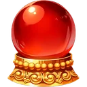 | **Bouncing Ball** tán qiú 弹球 | common | Physical | 35% of basic attacks release a spectral ball that bounces between enemies (70%, then 50%). A lone enemy gets it back off the wall (50%). | always |
| 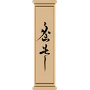 | **Calligraphy Brush** máo bǐ 毛笔 | common | Dark | +4 attack and +3% crit. Critical hits paint an ink Curse on the target (it takes 15% more damage and feeds your lifesteal). | zì 字 or xiě 写 |
|  | **Ember Tip** huǒ jiān 火尖 | common | Fire | Basic attacks set enemies Burning (2/s). Each hit on an already Burning enemy stokes it 1/s hotter (up to 8/s). | huǒ 火 |
| 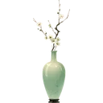 | **Five Petals** wǔ bàn 五瓣 | common | Light | Every 5th basic attack releases 2 magic petals that seek enemies (60% each) and heal you 1% when they land. | wǔ 五 |
|  | **Frost Tip** bīng jiān 冰尖 | common | Ice | Basic attacks Chill. Hitting an already-Chilled enemy has a 12% chance to Freeze it. | lěng 冷 or xuě 雪 or dōng tiān 冬天 |
|  | **Heavy Hand** zhòng shǒu 重手 | common | Earth | Attacks are 30% slower but deal +60% damage and knock enemies back. | always |
|  | **Long Spear** cháng qiāng 长枪 | common | Physical | Every basic attack ends in a piercing energy thrust: +20% to the target and 70% to every enemy up to two body-lengths behind it. | always |
| 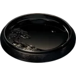 | **Splitting Ink** fēn mò 分墨 | common | Physical | Every basic attack throws 2 ink shards at other enemies (35% each). With only one enemy, the shards curl back into it (20% each). | always |
|  | **Sugar Rush** táng fèn 糖分 | common | Light | Every 9 seconds you eat a sweet (heal 2%). After any sweet, or any heal of 5% or more, your next basic attack deals +100% damage. | always |
|  | **Thunderous Impact** zhòng jī 重击 | common | Earth | Your hits push 50% further; critical hits push twice as far and Shock. | zhòng 重 or dǎ 打 |
| 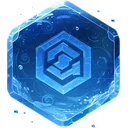 | **Tide Tip** shuǐ jiān 水尖 | common | Water | Basic attacks make enemies Wet, and every 4th one splashes a wave that soaks every enemy near the target. | shuǐ 水 |
|  | **Chain Hook** gōu suǒ 钩锁 | rare | Physical | Every 4th basic attack hooks its target and pulls it toward you instead of pushing it; pulled enemies take +25% damage for 2s. | lā 拉 |
|  | **Explosive Impact** bào liè 爆裂 | rare | Fire | 15% of your hits explode: 40% of the hit to everything around the target, the target included. | always |
|  | **Ink Mine** mò léi 墨雷 | rare | Dark | Every 4th basic attack plants a delayed ink seal on its target. 1.4 seconds later it explodes: 100% attack to everything nearby and Curse. | hēi 黑 |
|  | **Spark Arc** huǒ huā 火花 | rare | Lightning | +5% crit. Critical hits, and every 6th basic attack, release a lightning arc to another enemy (40% of the hit). A lone enemy is struck again from the sky. | diàn 电 |
| 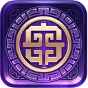 | **Sword Intent** jiàn yì 剑意 | epic | Physical | Every 5th basic attack releases a sword wave that cleaves every enemy on the battlefield, the target included, for 50% (each counts as a hit). | always |

## Movement (12)

| | Item | Rarity | Element | Effect | Unlock |
| --- | --- | --- | --- | --- | --- |
|  | **Desperate Pace** jí bù 急步 | common | Wind | +8% attack and move speed, and up to +50% more the more health you are missing. Below half health, every 4th attack throws a wind slash (50%). | kuài 快 |
|  | **Ember Trail** huǒ jì 火迹 | common | Fire | Moving leaves burning ground behind you (3s; enemies on it Burn). Standing still, you send out an expanding ember ring every 3 seconds (40% attack + Burn). | huǒ 火 |
| 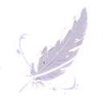 | **Long Stride** dà bù 大步 | common | Wind | +20% move speed and +6% dodge, and your dodge hop carries you only half as far back, so you keep your ground. | zǒu 走 or bù 步 |
|  | **Qinggong** qīng gōng 轻功 | common | Wind | +10% dodge. After a dodge you spring straight back in: your next attack strikes twice (the second at 60%). | always |
| 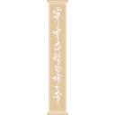 | **Relentless Advance** bù tuì 不退 | common | Physical | Recovering from a knockback grants +35% attack speed and +25% move speed for 3s. Being hit for 8% of your health or more grants it too. | zǒu 走 or pǎo 跑 |
| 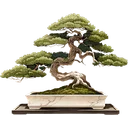 | **Rooted Stance** zhā gēn 扎根 | common | Earth | Holding your ground (attacking or standing without moving) builds armor: +1 defence per second, up to +10. Moving makes it crumble 2 per second instead of all at once. At full armor, attacks Stun briefly (every 4s). | shù 树 or shān 山 |
| 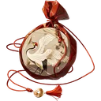 | **Swift Pursuit** shén xíng 神行 | common | Wind | +30% move speed. Your first attack after moving at least a body-length deals +30% damage. | kuài 快 or pǎo 跑 |
| 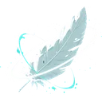 | **Wind Step** fēng bù 风步 | common | Wind | +8% dodge. Dodging releases a gust: nearby enemies are pushed back and take 30% attack as wind damage. | fēng 风 |
|  | **Countercurrent** nì liú 逆流 | rare | Wind | +5% dodge. When you hop back from a dodge or get knocked back, a gust pushes every enemy within reach back as well (25% attack as wind). | fēng 风 or shuǐ 水 |
|  | **Hit and Run** yóu jī 游击 | rare | Wind | +8% dodge. After you dodge: +50% move speed for 2s and your next attack deals +60% damage. | zǒu 走 |
|  | **Rebound** fǎn tán 反弹 | rare | Light | +8% dodge. Dodging a ranged attack reflects it back (150% of its damage); dodging a melee attack fires a counter-projectile at the attacker (80% attack). | always |
| 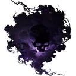 | **Shadow Double** yǐng zi 影子 | rare | Dark | +6% dodge. Every dodge summons a shadow of you that copies your basic attack 4 times (45% each, with all its effects). | hēi 黑 or yè 夜 |

## Dodging (8)

| | Item | Rarity | Element | Effect | Unlock |
| --- | --- | --- | --- | --- | --- |
|  | **Fanned Flames** shān huǒ 扇火 | common | Fire | +8% dodge. Dodging whips up a fire gust (30% attack + Burn to every enemy near you). Every new Burn you start leaps to one more enemy (or burns hotter on a lone one). | always |
| 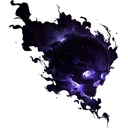 | **Ghost Step** guǐ bù 鬼步 | common | Dark | +8% dodge. Dodging leaves an illusion behind for 1.6s that draws most enemy attacks away from you. | always |
|  | **Rain Dancer** yǔ wǔ 雨舞 | common | Water | +8% dodge. Dodging splashes every enemy near you, and every 6th attack splashes its target: they become Wet (lightning then conducts, ice freezes them). | yù 雨 |
|  | **Slipstream** liú fēng 流风 | common | Wind | +8% dodge. After a dodge: +40% move speed for 1.5s, and your next 2 basic attacks are Wind (they push further and fan Burning enemies into Wildfire). | fēng 风 |
|  | **Afterimage** shǎn yǐng 闪影 | rare | Wind | +8% dodge. Every 2nd dodge summons a clone of you that copies your basic attack 5 times (60% each, with all its effects). | always |
|  | **Blade Dance** jiàn wǔ 剑舞 | rare | Wind | +6% dodge. Every dodge makes 2 extra attacks (70% each); with Momentum, 3. | always |
|  | **Counterstrike** fǎn jī 反击 | rare | Physical | +8% dodge. After a successful dodge, instantly counterattack (90% of a basic attack, with all its effects). | dǎ 打 |
|  | **Borrowed Time** jiè shí 借时 | epic | Light | +8% dodge. Every dodge, and every 7th attack, leaves a frozen afterimage of you. After 1 second each afterimage repeats your last attack (full strength, with all its effects). They pile up. | shí jiān 时间 |

## Defence (23)

| | Item | Rarity | Element | Effect | Unlock |
| --- | --- | --- | --- | --- | --- |
|  | **Barbed Seal** cì yìn 刺印 | common | Earth | Every 9 seconds the seal grants a 10 shield. Gaining a shield of 8 or more at once releases a thorn burst: 20 damage to every enemy near you. | always |
|  | **Bumper Crop** dà fēng shōu 大丰收 | common | Earth | Every enemy you defeat drops a seed (heal 2%), every 3rd one a peach (heal 7%). Every 10% of health you take from a boss, guardian or elite drops a peach too. | always |
| 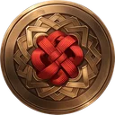 | **Bursting Shield** dùn bào 盾爆 | common | Earth | Every 8 seconds you grow a brittle 14 shield. Any shield of yours that breaks explodes (25 + half the shield as earth damage to everything near you); the brittle one also explodes when it runs out after 4s. | always |
|  | **Ember Armor** huǒ jiǎ 火甲 | common | Fire | +3 defence. Enemies that hurt you catch fire (Burn 3/s), and every Burning enemy gives you +3 more defence. | huǒ 火 or rè 热 |
|  | **Heavy Frame** chén zhòng 沉重 | common | Earth | +50% knockback resistance and +3 defence, but 10% slower movement. Melee enemies that hit you bounce off your bulk (pushed back 4). | zhòng 重 |
| 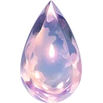 | **Ice Spikes** bīng cì 冰刺 | common | Ice | Taking damage fires ice spikes at the attacker: 8 ice damage and Chill. | lěng 冷 or xuě 雪 or dōng tiān 冬天 |
| 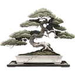 | **Iron Roots** tiě gēn 铁根 | common | Earth | +2 defence. While standing still you take 70% less knockback. | shù 树 or de 地 |
| 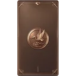 | **Iron Skin** tiě pí 铁皮 | common | Earth | +15% chance to block attacks (blocked hits deal 30%). Every block throws iron splinters back at the attacker (60% of your attack). | always |
|  | **Lucky Charm** hù shēn fú 护身符 | common | Light | +7% crit. Every critical hit grants a 3 shield. | always |
|  | **Overflowing Cup** mǎn yì 满溢 | common | Water | Every 6 seconds you sip from the cup (heal 3%). 30% of all your healing also becomes shield, and healing beyond full health becomes shield entirely. | shuǐ 水 or hē 喝 or chá 茶 |
| 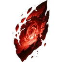 | **Rising Rage** nù qì 怒气 | common | Fire | Every 5 hits you take, your next basic attack deals double damage and knocks the target far back. | always |
| 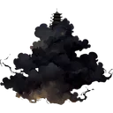 | **Soul Lantern** hún dēng 魂灯 | common | Light | Every enemy you defeat, and every 10% of health you take from a boss, guardian or elite, grants a 10 shield and recharges your signature 1s faster. | dēng 灯 |
|  | **Spring Tea** chá 茶 | common | Water | Regenerate 1% max HP per second. | chá 茶 or hē 喝 |
|  | **Surrounded** sì miàn 四面 | common | Earth | Take 6% less damage for every enemy close to you (up to 30%; at least 6% while any enemy is near). | always |
| 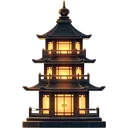 | **Territorial Guardian** shǒu tǔ 守土 | common | Earth | While you fight in your own half: +6 defence and take 12% less damage. | jiā 家 or de 地 |
|  | **Thorn Shell** cì ké 刺壳 | common | Earth | Every 7 seconds you grow 8 thorn armor (shield). Whenever you gain a shield, its thorns fly at the nearest enemy for half of it (at least 4). | always |
|  | **Vitality** huó lì 活力 | common | Light | +30 max HP. While above 70% health, every 4th attack releases a spark of life at a random enemy (50% attack, light). | always |
|  | **Golden Bell** jīn zhōng 金钟 | rare | Light | Once per battle, a heavy hit (4% of your health or more) is fully blocked and the attacker is stunned for 2s. | always |
|  | **Overflowing Ink** mò yì 墨溢 | rare | Dark | Every 5th attack you sip ink (heal 2%). Every heal fires an ink projectile at the nearest enemy (as much as you healed, at least 6); healing beyond full health becomes a piercing ink lance through every enemy (150% of the excess, up to 30% of your max health). | always |
| 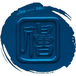 | **Second Refusal** zài jù 再拒 | rare | Earth | You raise a fragile 10 shield 2 seconds into every battle and every 10 seconds after. When any shield of yours breaks, a shockwave throws nearby enemies back (14) and deals 30% attack. | always |
|  | **Stone Bulwark** shí bì 石壁 | rare | Earth | Gain a 20 shield 3 seconds into every battle and every 10 seconds after. | shí tou 石头 or shān 山 or qiáng 墙 |
|  | **Storm Guard** léi dùn 雷盾 | rare | Lightning | +8% block. Every 3rd block, and every 6th hit you take, releases lightning at every enemy (20 damage + Shock). | diàn 电 |
| 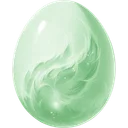 | **Turtle’s Revenge** guī jiǎ 龟甲 | epic | Earth | Being knocked back or hit stores kinetic energy in your shell. Your next attack releases all of it: bonus earth damage and a push that grow with the energy (up to 60). | shān 山 or shí tou 石头 |

## Signature moves (29)

| | Item | Rarity | Element | Effect | Unlock |
| --- | --- | --- | --- | --- | --- |
|  | **Afterglow** yú huī 余辉 | common | Light | After a successful signature move you glow for 5s: every basic attack releases a small energy pulse at a random enemy (40% attack, light), and you take 10% less damage. | always |
| 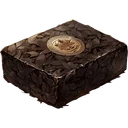 | **Bitter Lesson** jiào xun 教训 | common | Dark | Right answers teach the front enemy a lesson (Weakened for 3s: it deals 30% less). Wrong answers still lash out: every enemy takes 15 dark damage and your signature recharges 3s faster. | always |
|  | **Blood Blossom** xuè huā 血花 | common | Physical | After a successful signature move, your next 3 hits make their target Bleed (5/s for 4s). | always |
|  | **Charged Strike** xù lì 蓄力 | common | Physical | After a successful signature move, your next 2 basic attacks deal double damage. | always |
|  | **Charged Up** chōng diàn 充电 | common | Lightning | A successful signature move gives you Momentum for 4s, wherever you stand. If you already had it, you also get a 20 shield. | always |
| 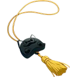 | **Forked Bolt** fēn chà 分叉 | common | Lightning | Every successful signature move strikes two random enemies with lightning (15 + Shock). | diàn 电 |
| 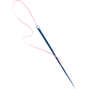 | **Impatience** xīn jí 心急 | common | Physical | +5% crit. Critical hits shorten your signature cooldown by 0.5s. | always |
|  | **Ink Reflection** mò yǐng 墨影 | common | Dark | Every successful signature move creates an ink reflection of you for 3s: it draws most enemy attacks to itself, and copies your next basic attack (full strength, with all its effects). | always |
| 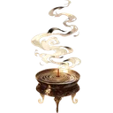 | **Lingering Power** chí jiǔ 持久 | common | Physical | Statuses you apply last 50% longer and your temporary bonuses 30% longer. Every successful signature move leaves a lingering field on the nearest enemy for 5s: enemies in it take 30% attack per second in your signature’s element, with its status. | always |
|  | **Patient Reward** hòu bào 厚报 | common | Light | Completing your signature puzzle grants a 10 shield; below half health it grants a 30 shield and heals 10%. | always |
| 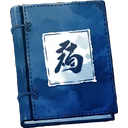 | **Perfect Memory** jì yì 记忆 | common | Light | Your first successful signature move each battle summons a memory spirit that fights beside you for 8s (60% attack every 0.6s, light). | jì de 记得 or xiǎng 想 |
|  | **Poised Mind** jìng xīn 静心 | common | Wind | +6% dodge. Every dodge recharges your signature 1s faster, and your next signature after a dodge also grants a 15 shield and Slows every enemy for 2s. | always |
| 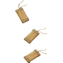 | **Quick Ink** kuài mò 快墨 | common | Physical | Each basic attack shortens your signature cooldown by 0.2s. | kuài 快 |
|  | **Signature Reservoir** shuǐ kù 水库 | common | Water | You start each battle with a charge, and every 6 basic attacks store another (up to 3). Your next successful signature move spends them: 2 spectral water blades per charge seek enemies (60% attack each). | shuǐ 水 |
|  | **Steel Veil** jiàn mù 剑幕 | common | Earth | A successful signature move grants an 8 shield for every enemy on the battlefield (at least 16). | always |
| 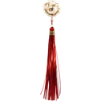 | **Still Water** zhǐ shuǐ 止水 | common | Water | A successful signature move cast without Momentum creates a tranquil pool around you for 6s: you heal 1.5% per second while in it, and enemies in it are Slowed and Wet (so Ice freezes them and Lightning conducts). With Momentum the pool is smaller and lasts 3s. | always |
| 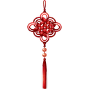 | **Chain Reaction** lián suǒ 连锁 | rare | Physical | After a successful signature move, your next 3 basic attacks set off elemental reactions: a target with a status takes a reacting burst (60% attack: Conduct, Explosion, Shatter, Purify or Eclipse); a target without one is soaked (Wet) so the next one reacts. | always |
|  | **Echoing Soul** huí shēng 回声 | rare | Physical | A successful signature move echoes a moment later, without another puzzle: Xinyi summons a second random fruit, Mei a follow-up sword slash, Huojin burns 3s longer with a fire pulse, Ruizhe another shield pulse and shockwave, Fuyun a clone whose strikes all crit, Lei a second shockwave that makes collisions crackle. | always |
| 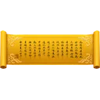 | **Final Word** zuì hòu yī jù 最后一句 | rare | Dark | After a successful signature move, your next 3 basic attacks deal +40% damage and each applies a random status. | always |
|  | **Honed Edge** mó dāo 磨刀 | rare | Physical | +7% crit. Each critical hit leaves a blade mark (up to 8). Your next successful signature move launches one piercing spectral blade per mark: each cuts through every enemy (30% attack). | always |
| 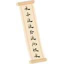 | **Ink Resonance** mò yùn 墨韵 | rare | Physical | Every successful signature move releases a wave of elemental energy (your attack’s element, or a random one): 18 damage and its status to every enemy. | always |
| 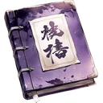 | **Reckless Magic** kuáng fǎ 狂法 | rare | Fire | Every successful signature move unleashes two offensive shockwaves across the field (60% attack each and a shove), but its cooldown is 35% longer. | always |
|  | **Resonance** gòng míng 共鸣 | rare | Light | Your first successful signature move each battle, and every 2nd one after, releases a radiant burst: 40 light damage to every enemy and heal 10%. | always |
| 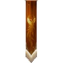 | **Roaring Spirit** hǒu shēng 吼声 | rare | Fire | After a successful signature move, attack 30% faster for 6s. | always |
| 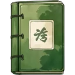 | **Second Thought** zài xiǎng 再想 | rare | Physical | Once per battle, a wrong answer can be retried without going on cooldown. After a right answer, your second thought sometimes comes quicker: 30% chance to recharge 2s faster. | xiǎng 想 |
|  | **Second Wave** èr dāo 二刀 | rare | Wind | Every successful signature move sends a wind wave across the battlefield: 60% attack to every enemy. | always |
| 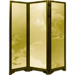 | **Storm Barrier** léi zhàng 雷障 | rare | Lightning | A successful signature move raises a crackling barrier in front of you for 6s. It zaps the nearest enemy every second (8 lightning), and enemies crossing it take 12 lightning, are Shocked and shoved back. | always |
|  | **Triple Blast** sān bào 三爆 | rare | Fire | Every successful signature move also sets off 3 fire explosions on random enemies (30% attack each, splashing nearby). | sān 三 or huǒ 火 |
| 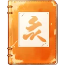 | **Wild Brush** kuáng bǐ 狂笔 | rare | Physical | Every successful signature move applies a random status to two enemies. | always |

## Momentum (14)

| | Item | Rarity | Element | Effect | Unlock |
| --- | --- | --- | --- | --- | --- |
| 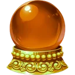 | **Cinder Heart** huǒ xīn 火心 | common | Fire | Your Burn and Bleed hit 25% harder (50% with Momentum). Every 4 seconds an ember flies at a random enemy and sets it Burning (4/s); with Momentum, every 2 seconds. | always |
|  | **Flame Mantle** huǒ pī 火披 | common | Fire | Taking damage releases a fire burst around you (12 + Burn), at most every 3s; with Momentum or a signature buff running, every 1s. | always |
|  | **Hearty Meal** bǎo cān 饱餐 | common | Fire | Four seconds into every battle and every 10 seconds after, you have a snack (heal 4%). Healing 4% or more at once gives you Momentum for 3s, wherever you stand. | always |
| 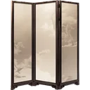 | **Last Stand** sǐ shǒu 死守 | common | Earth | While you do NOT have Momentum: +5 defence and take 15% less damage. | always |
|  | **Overextension** mào jìn 冒进 | common | Fire | While you have Momentum, deal 35% more damage but take 15% more. Without it, every 5th attack overreaches: +50% damage. | always |
|  | **Relentless** měng gōng 猛攻 | common | Wind | While you have Momentum: +10% attack speed, and every 5th attack throws a spinning wind blade that cuts the target and the enemy behind it (60%). Every 10th attack grants 2s of Momentum. | always |
|  | **Second Wind** huí qì 回气 | common | Wind | Losing Momentum immediately grants a 20 shield (at most every 4s). Taking a hit of 6% of your health or more catches your breath: a 10 shield (every 6s). Every 9 seconds you catch it anyway (8 shield). | always |
|  | **War Drum** zhàn gǔ 战鼓 | common | Earth | Every new battlefield: start with a 25 shield and 4s of Momentum. | dǎ 打 |
| 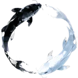 | **Ebb and Flow** cháo xī 潮汐 | rare | Water | Losing Momentum sends out a tidal wave (30% attack, Wet, push 8 to every enemy near you). Gaining it, and every 12 seconds the tide turns anyway, makes your next 3 attacks cleave (50% to everything around the target). | shuǐ 水 or hǎi 海 |
|  | **Endless Storm** wú jìn 无尽 | rare | Wind | +5% crit. Each critical hit gives you 0.6s of Momentum, or keeps it going 0.6s longer, even after you leave the enemy’s half. | always |
|  | **Invader’s Mark** rù qīn 入侵 | rare | Light | Stepping into the enemy’s half Marks every enemy near you for 5s (they take 20% more damage from you), and every 6th attack Marks its target for 3s. | always |
|  | **Thousand Cuts** qiān dāo 千刀 | rare | Wind | +5% crit. Each critical hit throws a wind blade at another enemy (40% of the hit; 70% with Momentum). | always |
| 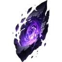 | **Cursed Crown** zǔ guān 诅冠 | epic | Dark | Momentum is twice as strong (double attack speed bonus, +15% damage), but you take 25% more damage while you have it. Every 8 seconds the crown forces 3s of Momentum on you, wherever you stand. | always |
| 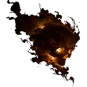 | **Trickster’s Mask** miàn jù 面具 | epic | Dark | Gaining Momentum (or every 10s without it) swaps you with the nearest enemy: it is left dazed behind you (Stun 0.8s) and your next attack is a guaranteed critical hit. At most once every 4s. | miàn 面 |

## Positioning and knockback (14)

| | Item | Rarity | Element | Effect | Unlock |
| --- | --- | --- | --- | --- | --- |
|  | **Forceful Impact** jué bù 绝不 | common | Wind | All your knockback is 40% stronger, and pushes of 3 or more deal 6 damage. | always |
| 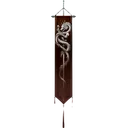 | **Gale Strike** jí fēng 疾风 | common | Wind | +6% crit. Critical hits knock enemies back further (+4). | always |
|  | **Hemorrhage** xuè bēng 血崩 | common | Physical | Every 5th attack is a rending shove (pushes 5). Strong pushes make their target Bleed (4/s); pushing an enemy that is already Bleeding tears it open: 10 damage and its Bleed lasts 2s longer. | always |
|  | **Hunter’s Instinct** liè rén 猎人 | common | Wind | +40% move speed while chasing enemies. Slowed, Chilled or Stunned enemies take 20% more damage from you, and every 5th attack trips its target (Slow 2s). | always |
|  | **Momentum Swing** guàn xìng 惯性 | common | Physical | Every 4th basic attack is a big swing: +30% damage and it knocks its target 3× as far. Pushes of 8 or more add 20% of your attack as impact damage. | always |
|  | **Sticky Ink** nián mò 粘墨 | common | Water | Basic attacks smear Sticky Ink on their target (up to 5 stacks). Any push of 1 or more consumes the stacks: Slowed for 1 + 0.6s per stack and 3 damage per stack. | always |
|  | **Stunning Blow** zhèn yūn 震晕 | common | Earth | +6% crit. Critical hits daze their target (Stun 0.3s, once every 3s per enemy). Enemies you slam into the far wall are Stunned for 1.2s. | always |
|  | **Wallbreaker** pò qiáng 破墙 | common | Earth | Heavy blows (critical hits and strong pushes) crack armor: +20% of your attack as earth damage. Enemies you knock into the far wall take big collision damage (more the faster they fly). | qiáng 墙 |
| 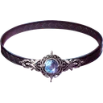 | **Arc Flail** diàn liàn 电链 | rare | Lightning | Every 4th attack lashes out with an electric chain: 50% attack lightning to the target and one more enemy. Pushes of 6 or more call down lightning (12 + Shock). | always |
|  | **Chain Collision** lián zhuàng 连撞 | rare | Physical | Every 6th attack is a body-check that shoves its target hard (10). Enemies you knock into other enemies pass on 60% of the force and both take 8; a lone enemy takes 15 from the check instead. | always |
|  | **Gravity Seal** xī yìn 吸印 | rare | Dark | Every 9 seconds a seal opens in front of you: it drags every enemy toward it, then detonates (25 + 8 per enemy caught, dark). | lā 拉 |
| 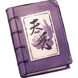 | **Ink Trail** mò jì 墨迹 | rare | Dark | Strong pushes leave a damaging ink trail behind the enemy (4 damage per second and Curse). Walking leaves small ink patches too (every 1.5s). | always |
|  | **Pile-Up** duī zhuàng 堆撞 | rare | Earth | Strong hits (critical hits and pushes of 4+) release a small shockwave around the target (15% attack, push 3). Wall slams release a big one that spreads between enemies (12 damage, push 6 to every neighbour). | always |
| 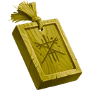 | **Thunderclap Drum** zhèn gǔ 震鼓 | epic | Lightning | Every 5th time you push an enemy, the drum booms: the same push (at least 6) hits every enemy near the target, which also takes 20% attack as lightning. Big groups go flying into each other. | dǎ 打 |

## Statuses and elements (8)

| | Item | Rarity | Element | Effect | Unlock |
| --- | --- | --- | --- | --- | --- |
|  | **Bleeding Edge** xuè rèn 血刃 | common | Physical | +5% crit. Critical hits make the target Bleed (4/s for 4s). | always |
|  | **Conductive Ink** dǎo mò 导墨 | common | Lightning | Every 4th basic attack soaks its target (Wet) and sparks a lightning arc to another enemy (40% attack; back into the target if alone). Your lightning hits on Wet enemies jump to the nearest other enemy for 60%. | diàn 电 |
| 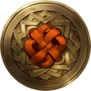 | **Ember Shield** huǒ dùn 火盾 | common | Fire | Every 6 seconds your shield flares: gain 6 shield and the nearest enemy Burns. Every enemy that starts Burning or Bleeding gives you a 5 shield. | always |
|  | **Holy Water** shèng shuǐ 圣水 | common | Light | Every 3rd basic attack leaves a radiant mark (Mark: +20% damage from you for 3s). Your attacks on Cursed enemies turn to Light and Purify them (double damage, an explosion and a little healing). | always |
|  | **Storm Edge** fēng rèn 风刃 | common | Lightning | +7% crit. Critical hits have a 35% chance to apply a random elemental status. | always |
|  | **Contagion** chuán rǎn 传染 | rare | Dark | Every 6th attack infects its target with a random status. When an enemy dies, all its statuses spread to every other enemy. Hitting an enemy that carries 3 or more statuses makes it erupt in blight (40% attack to everything around it). | always |
|  | **Glacier Fist** bīng quán 冰拳 | rare | Ice | +5% crit. Critical hits Chill (and Freeze a target that was already Chilled, 25%). Critical hits on Frozen enemies Shatter them. | lěng 冷 or xuě 雪 or dōng tiān 冬天 |
| 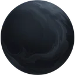 | **Ink Parasite** mò chóng 墨虫 | rare | Dark | Every 5th basic attack Curses its target. Statuses you apply spread to another enemy 30% of the time (on a lone enemy, they last 1s longer instead). | always |

## Conditional (11)

| | Item | Rarity | Element | Effect | Unlock |
| --- | --- | --- | --- | --- | --- |
|  | **Adaptation** yìng biàn 应变 | common | Earth | Every 5 seconds you adapt: a random enemy gains a random status. Whenever an enemy gains a new status from you, you gain a 4 shield. | always |
|  | **Ashes** huī jìn 灰烬 | common | Fire | 20% of your hits ignite the target (Burn 3/s). Hitting a Burning enemy shakes loose a healing ember now and then (1.5%, every 3s), and Burning enemies that die release a big one (6%). | huǒ 火 |
| 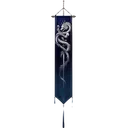 | **Back to the River** bèi shuǐ 背水 | common | Physical | +12% attack speed for each enemy beyond the first. One-on-one, your back is to the river: every 4th attack strikes twice (the second at 70%). | always |
|  | **Boundary Stone** jiè shí 界石 | common | Earth | Enemies standing in your half take +25% damage from you (drive them out and deny their Momentum); enemies cornered against the far wall take +15%. Every 6 seconds the stone erupts on the midline: enemies near it take 50% attack and are shoved back to their side. | shí tou 石头 or shān 山 |
|  | **Frost Hunter** liè bīng 猎冰 | common | Ice | Every 4th basic attack Chills its target. You deal +40% damage to Chilled or Frozen enemies. | lěng 冷 or xuě 雪 or dōng tiān 冬天 |
|  | **Hex Mark** zǔ zhòu 诅咒 | common | Dark | +7% crit. Every 3rd critical hit Curses the target. | hēi 黑 or yè 夜 |
|  | **Reckless Charge** měng chōng 猛冲 | common | Fire | Each time you gain Momentum, and every 8th attack, your next attack deals +100% damage and knocks its target far back. | pǎo 跑 or kuài 快 |
|  | **Battle Standard** zhàn qí 战旗 | rare | Physical | Momentum also grants +18% damage and +10% more attack speed. Without Momentum, every 6th attack plants the standard: Momentum for 2.5s, wherever you stand. | dǎ 打 or qián 前 |
|  | **Blood Moon** xuè yuè 血月 | rare | Dark | +8% lifesteal and +20% dark damage. Every 4 seconds a blood-red crescent cuts the nearest enemy (60% attack, dark) and heals you for 30% of it. | yuè 月 or yuè liang 月亮 or xuè 血 |
|  | **Sun Mirror** rì jìng 日镜 | rare | Light | Every 5 seconds the mirror warms you (heal 2%) and fires a light beam at the nearest enemy: 10 damage plus double everything you healed since the last beam. | tài yang 太阳 or yáng guāng 阳光 or guāng 光 |
|  | **Thunder Drum** léi gǔ 雷鼓 | rare | Lightning | Every 4 seconds, lightning strikes the strongest enemy for 25 (more on Wet enemies). | diàn 电 or dǎ 打 |

## Strange and build-changing (18)

| | Item | Rarity | Element | Effect | Unlock |
| --- | --- | --- | --- | --- | --- |
|  | **Broken Hourglass** pò shā lòu 破沙漏 | common | Physical | Every 6th basic attack, time slips: +80% attack speed for 2s. | always |
|  | **Lucky Cat** zhāo cái māo 招财猫 | common | Light | +8% crit and +25% ink from battles. A quarter of your critical hits toss a lucky coin at a random enemy (30% attack). | māo 猫 |
|  | **Blood Pact** xuè qì 血契 | rare | Dark | Each basic attack costs 1% of your health (never below 25%) but fires 2 blood darts at random enemies (30% each). Each enemy defeated, and every 10% of a boss’s health, restores 8%. | xuè 血 |
|  | **Bottled Storm** píng zi 瓶子 | rare | Lightning | Battles start with Wet ground, and the bottle uncorks again every 12s. While the ground is Wet, lightning strikes a random enemy every 3 seconds (12 + Shock); your lightning electrifies the ground. | diàn 电 or yù 雨 |
|  | **Broken Compass** pò luó pán 破罗盘 | rare | Physical | Attacks target random enemies, but deal +45% damage. | always |
|  | **Chaotic Scroll** luàn juàn 乱卷 | rare | Physical | Every 5 seconds something random happens (a status, a shield, a lightning bolt or a shove), and whenever another of your passive items triggers there’s a small chance of one more. | always |
|  | **Echo Brush** huí bǐ 回笔 | rare | Physical | Hitting the same enemy with the same element twice in a row adds a weaker echo hit (50%). | always |
|  | **Glass Brush** bō li 玻璃 | rare | Physical | +60% damage, but −35% max HP. Critical hits shatter into glass shards that fly at another enemy (25% of the hit; the same one if it’s alone). | always |
|  | **Hungry Lantern** è dēng 饿灯 | rare | Dark | Every enemy loses 1.5% max HP per second, but your healing is halved. | è 饿 or dēng 灯 |
|  | **Lingering Spirit** cháng míng 长明 | rare | Light | Every temporary bonus you gain (signature buffs, item buffs, Momentum effects) lasts 30% longer. Every 8 seconds a spark of spirit grants a random bonus for 3s: +25% attack speed, +15% crit or +20% damage. | always |
|  | **Mirror Brush** fǎn bǐ 反笔 | rare | Dark | 20% of your basic attacks repeat from the opposite direction: a 60% echo that yanks the target toward you. | always |
|  | **Mirror Ink** jìng mò 镜墨 | rare | Dark | Every 3rd basic attack sends a spectral copy of itself at the furthest enemy (80%, with all its effects). | always |
|  | **Paper Lanterns** zhǐ dēng long 纸灯笼 | rare | Fire | Every 8 seconds a paper lantern drifts down onto the battlefield in front of the nearest enemy. The first enemy to touch it sets it off: a fire blast (45 + Burn) to everything nearby. | dēng 灯 |
|  | **Ring of Swords** jiàn huán 剑环 | rare | Physical | Three spectral swords circle you, cutting every enemy within reach (15% attack twice a second). Critical hits add a sword for 6s (up to 6). Every 3 seconds the ring flings a sword at the furthest enemy (60%). | always |
|  | **Mirror World** jìng zhōng shì jiè 镜中世界 | epic | Dark | Your mirror self fights from the far side of the battlefield: every basic attack is copied from behind the enemies at the furthest one (50%, with all its effects), pulling it toward you. | shì jiè 世界 |
|  | **Paper Phoenix** zhǐ fèng 纸凤 | epic | Fire | Once per run, survive fatal damage: return with 40% HP and fiery attacks for the rest of the battle. Until then, a paper phoenix circles you: every 6s it swoops at the nearest enemy (60% attack + Burn). | always |
|  | **The Red Thread** hóng xiàn 红线 | epic | Physical | Every enemy you hit is tied to another by a red thread for 4s: it shares 30% of the damage you deal, and knocking one back drags the other along. A lone enemy feels the thread snap back (15% again). | hóng 红 or xiàn 线 |
|  | **Twin Shadows** shuāng yǐng 双影 | epic | Dark | A shadow twin follows you all battle and copies each of your basic attacks at 35% strength, with all their effects. | always |

## Synergies (60)

A synergy switches on by itself when you own all the items it lists.

| Synergy | Needs | Effect |
| --- | --- | --- |
| **All Together** yì qǐ 一起 | Resonance + Patient Reward | Every successful signature move counts double toward Resonance (so it bursts every time), and each burst also grants a 20 shield and calls two spirit companions to fight beside you for 5s. |
| **Avalanche** bīng bēng 冰崩 | Wallbreaker + Frost Tip | Enemies you slam into the wall or push 2 or more are Chilled, and Frozen ones Shatter. |
| **Black Hole** hēi dòng 黑洞 | Gravity Seal + Explosive Impact | Gravity Seals open every 6s instead of 9s, and their detonation Stuns everything caught for 1s. |
| **Blade Storm** jiàn fēng 剑风 | Second Wave + Blood Blossom | Second Wave deals double damage to Bleeding enemies and makes the others Bleed. |
| **Blood Crown** xuè guān 血冠 | Cursed Crown + Overextension | While you have Momentum, 12% of the damage you deal heals you. |
| **Border Wall** jiè qiáng 界墙 | Boundary Stone + Territorial Guardian | Every 6 seconds, any enemy standing in your half is driven back across the midpoint, and the boundary stone grows a 15 shield on you. |
| **Bouncing Bomb** tán bào 弹爆 | Bouncing Ball + Triple Blast | Bouncing Balls become bombs: every bounce explodes (40% attack to everything around it) and splits into 2 fragments that seek enemies (15% each). |
| **Chain Blast** lián bào 连爆 | Explosive Impact + Splitting Ink | Explosive Impact explosions throw shrapnel at another enemy too. |
| **Chain Explosion** bào zhà 爆炸 | Ember Tip + Splitting Ink | Burning enemies explode on death (30 fire to everything nearby, spreading their Burn), and ink shards that hit a Burning enemy explode too (20% attack). |
| **Chaos Echo** hùn luàn 混乱 | Echoing Soul + Wild Brush | Echoing Soul’s echo takes a random element and soaks every enemy in that element’s status. |
| **Clockwork** fā tiáo 发条 | Broken Hourglass + Quick Ink | Each Broken Hourglass surge recharges your signature 1s faster, and during the surge every attack leaves a delayed spectral copy of itself (50%) that strikes a moment later. |
| **Crimson Tide** xuè cháo 血潮 | Bleeding Edge + Hemorrhage | Bleeding enemies take 25% more damage from critical hits, and Bleed heals you a little. |
| **Deep Freeze** bīng fēng 冰封 | Frost Tip + Frost Hunter | Frost Tip freezes 25% of the time, and Frozen enemies take +75% from Frost Hunter. |
| **Demolition** chāi chú 拆除 | Wallbreaker + Chain Collision | Wall slams explode: enemies near the impact take damage too and are Stunned. Chain Collision’s body-check detonates as well (40% attack around the target, Stun 0.5s). |
| **Downpour** bào yǔ 暴雨 | Rain Dancer + Spark Arc | Spark arcs seek Wet enemies, and dodging electrifies the ground (Wet ground becomes Electrified). |
| **Echo Brushwork** huí yīn 回音 | Echo Brush + Five Petals | Echo Brush also echoes extra hits, and every item projectile or burst that hits the same enemy twice in a row echoes too (40%). |
| **Ember Fortress** huǒ chéng 火城 | Ember Armor + Ember Trail | While your burning ground or ember rings are alight, gain a 3 shield every second. |
| **Erudite Storm** bó xué 博学 | Chain Reaction + Storm Edge | Every successful signature move whips up a storm of elements: every enemy gains 2 different random statuses. Your critical hits spread every status on their target to another enemy. |
| **Fighting Spirit** zhàn yì 战意 | Battle Standard + Relentless Advance | While you have Momentum: +15% critical chance and 20% less knockback taken. |
| **Final Verdict** pàn jué 判决 | Final Word + Invader’s Mark | Final Word’s empowered attacks also Mark their targets (they take 20% more from you). |
| **Firestorm** huǒ fēng bào 火风暴 | Wind Step + Ember Tip | Dodging whips up a firestorm that sets every enemy Burning (at most every 3s). |
| **Frost Fortress** bīng chéng 冰城 | Ice Spikes + Bursting Shield | Bursting Shield explosions also Freeze enemies. |
| **Ghost Army** yīn bīng 阴兵 | Ghost Step + Twin Shadows | Ghost Step’s illusions fight back (copying your attacks), and your shadow twin’s strikes Curse. |
| **Glass Phoenix** fèng huáng 凤凰 | Paper Phoenix + Glass Brush | Paper Phoenix revives you at full health, and its swoops shatter into glass shards (3 more hits at 25%). |
| **Gluttony** tān lán 贪婪 | Hungry Lantern + Blood Moon | The Hungry Lantern feeds you: no healing penalty, and it heals you for 30% of its damage. |
| **Golden Light** jīn guāng 金光 | Golden Bell + Vitality | Golden Bell rings twice per battle, and every ring brings a giant golden bell crashing down on the enemies: 250% attack to everything under it and a 1.5s Stun. |
| **Hall of Mirrors** jìng gōng 镜宫 | Mirror World + Mirror Ink | Your mirror self strikes at 80% instead of 50%, and every one of its strikes is a critical hit. |
| **Healing Wave** quán bō 泉波 | Overflowing Ink + Spring Tea | Every 4th sip of Spring Tea ripples outward as a healing wave (12 water damage and a push to every enemy near you). Healing 5% or more at once releases a bigger wave that grows with the heal. |
| **Hidden Blades** àn qì 暗器 | Shadow Double + Second Wave | Every successful signature move also summons a shadow double that keeps copying your attacks for 3s. |
| **Hold the Line** shǒu chéng 守城 | Territorial Guardian + Iron Roots | In your own half you cannot be knocked back, and melee attackers take 30% of their damage back. |
| **Human Wave** rén làng 人浪 | Thunderclap Drum + Pile-Up | The Thunderclap Drum booms every 3rd push instead of every 5th, and every boom sends the target crashing into whoever stands behind it. |
| **Inferno** liè huǒ 烈火 | Ashes + Cinder Heart | Burning enemies explode when they die (30 to enemies nearby) and recharge your signature 1s faster; every healing ember also sparks a small explosion (20% attack). |
| **Ink Bloom** mò huā 墨花 | Ink Parasite + Wild Brush | Ink Parasite spreads statuses 60% of the time, and Wild Brush hits 4 enemies. |
| **Ink Weaver** biān zhī 编织 | Quick Ink + Resonance | Resonance bursts on every successful signature move. |
| **Iron Shell** tiě ké 铁壳 | Turtle’s Revenge + Heavy Frame | Hits store twice as much energy in Turtle’s Revenge, and releasing 30 or more also grants you a shield worth half of it. |
| **Lightning Rod** bì léi 避雷 | Conductive Ink + Tide Tip | Every 3 seconds, lightning strikes a Wet enemy for 30 and Conducts to every other Wet enemy. |
| **Line Breaker** pò zhèn 破阵 | Thunderous Impact + Heavy Frame | Enemies you knock back at least 4 are Stunned for 0.6s. |
| **Lucky Star** fú xīng 福星 | Lucky Cat + Lucky Charm | +10% critical chance. A quarter of your critical hits call down a falling star: 60% attack as light to everything where it lands, and it heals you 2%. |
| **Overcharge** chāo zài 超载 | Signature Reservoir + Charged Strike | Stored Reservoir charges also empower basic attacks (+20% per charge). |
| **Phantom Dance** huàn wǔ 幻舞 | Ghost Step + Slipstream | Every dodge also grants an 8 shield, and Ghost Step’s illusions explode for 25 when they fade. |
| **Puppet Strings** kuǐ lěi 傀儡 | The Red Thread + Chain Collision | Red threads last 10s, and threaded enemies knocked into each other or into the wall burst at the seams (50% attack to everything around them). |
| **Radiant Guardian** shǒu hù 守护 | Sun Mirror + Overflowing Cup | Every 5 seconds the mirror catches the light (10 shield), and while shielded you reflect 30% of incoming hits as light damage. |
| **Resounding Echo** huí xiǎng 回响 | Echoing Soul + Lingering Power | Echoing Soul’s echo is as strong as the original move. |
| **Rooted Mountain** shān yuè 山岳 | Rooted Stance + Stone Bulwark | Holding your ground raises a stone fortress: Stone Bulwark shields every 5s while you stand still, and while Rooted Stance has 6+ armor, rock walls burst up in front of you every 4s (80% attack to everything there, push 6, and an 8 shield). |
| **Shadow Parasite** jì shēng 寄生 | Blood Moon + Hex Mark | Hitting a Cursed enemy heals you 2% HP, and Blood Moon crescents Curse what they cut. |
| **Shatter Smash** fěn suì 粉碎 | Frost Tip + Heavy Hand | Your heavy attacks count as Earth against Frozen enemies, so they Shatter them (×2.5). |
| **Spark Storm** léi bào 雷暴 | Forked Bolt + Spark Arc | Spark Arc releases two arcs each time. |
| **Static Field** jìng diàn 静电 | Storm Guard + Iron Skin | Storm Guard discharges every 2 blocks and stuns instead of shocking. |
| **Storm Conductor** léi diàn 雷电 | Tide Tip + Spark Arc | Crit arcs seek Wet enemies, and every Conduct reaction triggers an extra basic attack. |
| **Storm Flail** léi suǒ 雷锁 | Wallbreaker + Spark Arc | Every enemy that slams into the wall, and every push of 2 or more (every 0.8s), releases lightning that arcs to two other enemies (15 each; struck from the sky if alone). |
| **Storm Hammer** léi chuí 雷锤 | Thunderous Impact + Arc Flail | Every push of 2 or more Shocks its target, and Shocked enemies that hit the wall or another enemy pass the Shock (and 20% attack) to their neighbours. |
| **Thunder Counter** léi jī 雷击 | Counterstrike + Spark Arc | Counterattacks are always critical hits, so every dodge ends in a lightning arc. |
| **Thunder God** léi shén 雷神 | Arc Flail + Storm Barrier + Charged Up | Storm Barriers become the wrath of heaven: they last twice as long, zap harder, call down lightning on everything near them every 2s (80% attack), and every enemy that crosses one is struck by lightning (100% attack, long Shock) and recharges your signature 1s. |
| **Time Loop** xún huán 循环 | Borrowed Time + Afterimage | Every Borrowed Time afterimage repeats your attack twice, and every Afterimage clone leaves a frozen afterimage of its own. |
| **Twin Mirrors** shuāng jìng 双镜 | Mirror Ink + Broken Compass | Mirror Ink fires every 2nd attack at full damage, and a second reflection strikes from the other side at the nearest enemy at the same time: attacks rain in from both ends of the battlefield. |
| **Unshakeable** bù dòng 不动 | Iron Roots + Stone Bulwark | While you have a shield you can’t be knocked back and take 20% less damage. |
| **Vanguard Charge** chōng fēng 冲锋 | Reckless Charge + Swift Pursuit | Gaining Momentum also grants +40% attack speed for 4s. |
| **Wildfire Dance** yě huǒ 野火 | Wind Step + Ember Trail | Wind Step gusts carry your fire: every enemy they hit starts Burning, and every ember ring also releases a gust. |
| **Wind Dancer** fēng wǔ 风舞 | Qinggong + Shadow Double | +15% attack speed, +5% dodge, and shadow doubles last twice as long. |
| **Wind Rider** yíng fēng 迎风 | Countercurrent + Hit and Run | Every dodge also grants a 12 shield and +25% dodge for 1.5s. |
